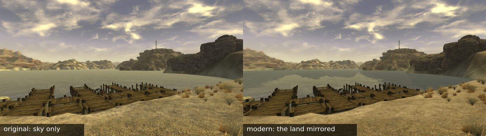
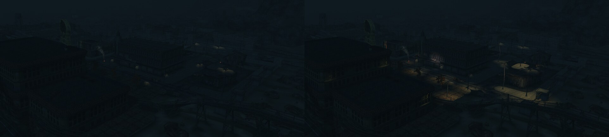
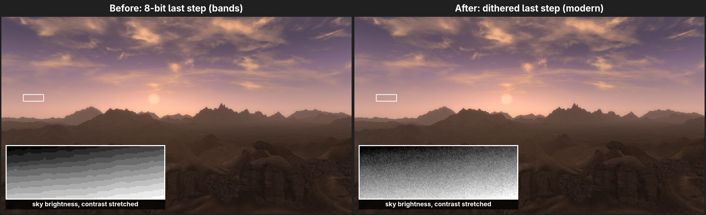
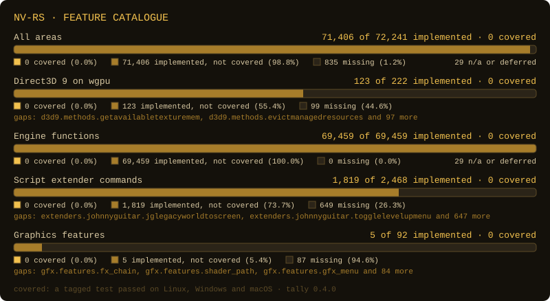
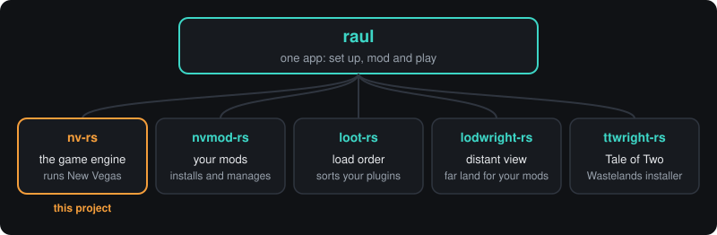

  

<h1 align="center">nv-rs</h1>

<b>Fallout: New Vegas on a new engine, rebuilt in Rust.</b>

nv-rs runs your own copy of Fallout: New Vegas on a new engine: the original program, translated piece by piece into
the Rust programming language.
It is for players who want the game on Linux, Windows or macOS, with optional modern graphics.
An engine is the program that runs a game: it draws the world and runs its rules. The game's own files stay the same.

> **A fork.** This is a fork of [slaterain/nv-rs](https://github.com/slaterain/nv-rs); upstream's engine work is pulled
> in regularly. We forked to organise the work our own way and to make releases easily, for [raul](#get-it).

  
   <em>Goodsprings: the original look (left) and the <code>modern</code> preset (right), with shadows and soft shade.</em>

## What it does for you

- 🎮 **The whole game.** Quests, combat, menus, saves and the DLCs run on the new engine.
- 🐧 **Linux and Windows, macOS in testing.** On Linux it runs natively, with no Windows layer in between.
- 🌅 **Better light, your choice.** The default looks like the original. One switch turns on shadows, soft shade and
  light from the sky. Press **F10** in the game to change the graphics settings.
- 🧩 **Script extenders built in.** Many mods need the add-ons xNVSE or JIP LN. Here they are part of the engine,
  so there is nothing extra to install.

  
   <em>Lake Mead: the game's water (left) and the new reflections (right), which mirror the hills and piers.
  Coming in the next release.</em>

  
   <em>Primm at night: lamps that fade out close by (left), and the <code>modern</code> preset (right), where every
  street lamp around you lights its ground.</em>

  
   <em>Sunsets and the night sky: 8-bit colour bands (left) and the smooth last step of <code>modern</code> (right).</em>

## Progress

One bar per area of the [coverage catalogue](docs/fork/CATALOGUE.md): every Direct3D 9 method and render state, every
engine function, every script extender command, every graphics feature, and the engine features you know from the
game (LOD drawing, the Pip-Boy map, V.A.T.S., save games) with the move to 64-bit, threads and Vulkan. Each bar shows how many items are
**covered** (a tagged test passed on Linux, Windows and macOS), **passing** on at least one system, **tagged** by a
test, **implemented**, and **missing**. The first row adds up every area except the engine functions, which keep their
own row. The engine features have two bars: how many are fully native code, and how much native code they hold
on average. Their grey-blue part still works, through the game's own code
([how they are counted](docs/fork/ENGINE-FEATURES.md)). The picture is redrawn by the project's bot after every change on `fork`; nobody edits it.

  

The older progress pictures (engine port, native code, Direct3D 9, extenders, graphics plan) are in
[docs/fork/PROGRESS.md](docs/fork/PROGRESS.md).

<b>What the engine can do today</b> (a table per system)

This table is upstream's account of the engine, kept here because it describes this fork's engine too. Each name
links to the detail in [docs/STATUS.md](docs/STATUS.md).

| | System | What you get today |
| :---: | --- | --- |
| ✅ | [**The whole game**](docs/STATUS.md#the-whole-game) | Combat, AI, quests, dialogue, menus, saves, the open world and the DLCs, checked against the original and playable. |
| ✅ | [**Fixes**](docs/STATUS.md#fixes) | Bug fixes on by default, each with its own setting; the original's behaviour is one setting away. |
| 🔨 | [**Native 64-bit code**](docs/STATUS.md#native-64-bit-code) | Started: threads on their own cores, textures and sounds kept outside the 32-bit memory, and the first hot paths as native code (the script evaluator, the world draw's device calls, the actors' per-frame loops). |
| 🔨 | [**Built-in script extender: xNVSE**](docs/STATUS.md#xnvse-built-in) | All 654 of its script commands and both its script languages, with nothing to install. |
| 🔨 | [**Built-in script extender: JIP LN:**](docs/STATUS.md#jip-ln-built-in) | All its script commands (JIP LN: 1,116 and its two version commands) and all of its game patches that do something on this port (174 of 183; three more are folded into others, six do nothing here); on in the default fixes preset, off in vanilla (`bJIPInstalled=0` turns it off). |
| 🔨 | [**Mod Configuration Menu (MCM)**](docs/STATUS.md#mod-configuration-menu-mcm-built-in) | The commands MCM's menu needs; on in the default fixes preset (`bMCM=0` turns it off). |
| 🔨 | [**UI Organizer (UIO)**](docs/STATUS.md#ui-organizer-uio-built-in) | UI mods' HUD and menu additions; on in the default fixes preset (`bUIO=0` turns it off). |
| 🔨 | [**lStewieAl's Tweaks**](docs/STATUS.md#lstewieals-tweaks-built-in) | 225 of its changes, on by default: its 72 listed crash and leak fixes and 153 more fixes and tweaks; the remaining crash fixes and tweaks come next. |
| 🔨 | [**Mod installers (FOMOD)**](docs/STATUS.md#mod-installers-fomod) | Mods with an installer, from .zip or .7z, installed into nv-rs's own folder, never the game's. |
| 🔨 | [**Modern graphics (wgpu)**](docs/STATUS.md#modern-graphics-wgpu) | The default renderer, on Vulkan; in the places compared, on one NVIDIA card, its pictures nearly match Direct3D 9's, and at 8x antialiasing it is about 8% slower. |
| 🔨 | [**Game pads**](docs/STATUS.md#game-pads) | Xbox-style pads on Windows as in the original; other pads, and Linux, not yet tried with a real pad. |
| ⬜ | [**More platforms, co-op, VR**](docs/STATUS.md#more-platforms-co-op-vr) | Planned; co-op has no design yet. |

✅ means working, not free of bugs. Each fix is described in [docs/FIXES.md](docs/FIXES.md).

## How it fits together

  

The work is split into parts so each one can be built and tested on its own; raul puts them together in one app.

## Get it

**[Download raul](https://github.com/JorisJonkers-dev/rauls-trusty-toolbox/releases/latest)**: it has this engine
built in, and sets up the game and your mods for you.

## Learn more

- [What the fork adds, in detail](docs/fork/FEATURES.md): graphics settings, Linux and macOS, downloads, contributing.
- [Graphics settings](docs/fork/GRAPHICS.md) and [every other document](docs/README.md).

## Credits

nv-rs builds these mods in, translated into Rust from their published source and distributed as
their licences allow (each crate's `NOTICE` and every package carry the notices). No C++ of theirs
is included; one data file, UI Organizer's list of the UI mods it supports (`supported.txt`), is
included unchanged.

- **[xNVSE](https://github.com/xNVSE/NVSE)**, the New Vegas Script Extender: the original NVSE by
  Ian Patterson, Stephen Abel, Paul Connelly and Hugues LE PORS (ianpatt, behippo, scruggsywuggsy
  the ferret and hlp); xNVSE by korri123, cnf13, jazzisparis, Demorome and its contributors, with
  the code xNVSE carries from Algohol (entim) and the MT19937 generator (Makoto Matsumoto and
  Takuji Nishimura).
- **[JIP LN NVSE](https://github.com/jazzisparis/JIP-LN-NVSE)** by jazzisparis, with its game
  patches and the commands that began as the lutana NVSE plugin.
- **[UI Organizer](https://github.com/jazzisparis/UIO-User-Interface-Organizer)** by jazzisparis
  (Jef).
- **[JohnnyGuitar NVSE](https://github.com/carxt/JohnnyGuitarNVSE)** by carxt and its
  contributors: its editor ids and its corrections to JIP LN's co-save.
- The fixes preset's "No LOD Water" flag on The Strip, found by Aqua Performa's author.

The community decompilation [fnv_decomp](https://github.com/momusdigital/fnv_decomp) is read
alongside the game's program as a reference for names, types and logic.

nv-rs is not affiliated with Bethesda, ZeniMax, Obsidian or Microsoft, and contains no game files: you need your own
copy of the game. GPL v3 or later; see [LEGAL.md](LEGAL.md) and [LICENSE](LICENSE).
