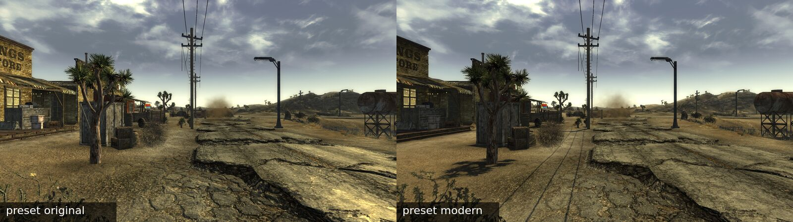
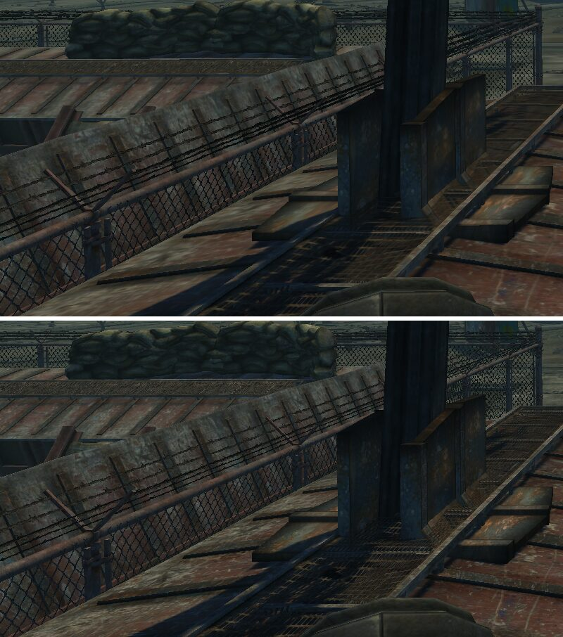

  

<h1 align="center">nv-rs (JorisJonkers-dev fork)</h1>

  
  
  

**Fallout: New Vegas, rebuilt in Rust.** nv-rs is a new engine for the game: the original program is translated
into Rust function by function and runs your own copy's game files. This repository is a fork of
[slaterain/nv-rs](https://github.com/slaterain/nv-rs). It adds graphics options, native builds for Linux and macOS,
and the pieces needed to run the engine inside [raul](#raul-the-easy-way-to-play), a desktop app that installs,
mods and starts the game.

> [!IMPORTANT]
> nv-rs is an independent project, not affiliated with or endorsed by Bethesda Softworks, ZeniMax Media, Obsidian
> Entertainment or Microsoft. It contains no game files: you need your own legally obtained copy of the game. See
> [LEGAL.md](LEGAL.md).

## A fork of slaterain/nv-rs

The engine is slaterain's work. This fork follows upstream closely: upstream's commits are replayed onto our
default branch `fork` regularly, with their authors, dates and an `Upstream-Commit` trailer, so engine work done
upstream reaches this repository and its releases. `main` is an exact mirror of upstream's `main`.

We forked for two reasons. The work here is organised differently: required checks, Conventional Commits,
release-please, fuzzing, and builds for three systems on every pull request. And we wanted to make releases
easily and often, for Linux, Windows and macOS, so that raul can ship a tested engine with every version. How the
fork follows upstream is in [FORK.md](FORK.md) and [docs/fork/KEEPING-IN-SYNC.md](docs/fork/KEEPING-IN-SYNC.md);
everything the fork changes in upstream's files is listed, with the reason, in
[docs/fork/divergence.d/](docs/fork/divergence.d/). For the project's own story, roadmap and community, read
[upstream's README](https://github.com/slaterain/nv-rs#readme) and join its
[Discord](https://discord.gg/pn5kjZJJxx).

## raul: the easy way to play

[Raul's tRusty Toolbox](https://github.com/JorisJonkers-dev/rauls-trusty-toolbox) (`raul`) is one program for
Linux, Windows and macOS that finds your game, sets up Tale of Two Wastelands if you want it, installs and sorts
your mods, builds the distant land (LOD) for your load order, and starts the game on this engine. The engine is
built into raul, so there is nothing else to install.

  

**[Download raul](https://github.com/JorisJonkers-dev/rauls-trusty-toolbox/releases/latest)**: an AppImage, `.deb`
or `.tar.gz` for Linux, a setup `.exe` or portable `.zip` for Windows, and a `.dmg` for macOS. raul's
[README](https://github.com/JorisJonkers-dev/rauls-trusty-toolbox#readme) has the install steps and the checksums.

## What the fork adds

### Graphics presets and the F10 overlay

The engine draws the original picture by default. A graphics preset turns on the port's own effects together:
`original` (the default, every setting at the game's value), `modern` and `performance`. While the game runs,
**F10** opens an overlay that lists every setting, where its value comes from, and applies a change in the next
frame; the change is saved in the profile's `nv-rs-graphics.toml`. All of it is described in
[docs/fork/GRAPHICS.md](docs/fork/GRAPHICS.md).

  
   <em>Goodsprings, the same place and load order: preset <code>original</code> (left) and <code>modern</code> (right).
  Sun shadows, ambient occlusion and the light balance give the ground and buildings depth.</em>

What `modern` turns on, each also adjustable on its own:

| Setting | What it does |
| --- | --- |
| Ambient occlusion and sun shadows | The port's soft shade in corners and its shadows from the sun and moon, with quality levels and strength. Upstream has the effects; the fork makes them settings with levels and presets. |
| Light balance | The game's flat fill light is reduced where the port's own shade and the light from the sky take its place, so `modern` does not look washed out. |
| Sky light, moon and starlight | Light from the sky by surface direction, a moon light that follows the game's moon phase, and a dim starlight at night. |
| Moon highlight | Glossy materials catch the moon light a little. |
| Lamp light distance | Lamps, street lights and lit signs light their surroundings from further away. |
| Water reflections | Lakes and rivers placed above the world's water height (Lake Mead, the Colorado) mirror the land as well as the sky. |
| Anisotropic filtering | Textures seen at a grazing angle (roads, fences, roofs) stay sharp; `modern` uses x16. |

  
   <em>Lake Mead on the plain game. The original game mirrors only the sky in water placed at its own height (left);
  with <code>water.placed_reflections</code> the cliffs are mirrored too (right).</em>

  
   <em>A street fence at a grazing angle with the game's anisotropy at 1, as its Low and Medium settings set it
  (top), and with forced x16 anisotropic filtering (bottom).</em>

Lamp light distance, water reflections and anisotropic filtering are on the `fork` branch and come with the next
release after v0.24.0; the other settings are in v0.24.0.

### More

- **Linux and macOS.** The engine builds and runs natively on Linux (Vulkan through wgpu, X11 or Wayland, sound
  through PulseAudio or PipeWire); macOS builds are made and tested in part. See [docs/fork/LINUX.md](docs/fork/LINUX.md).
- **Mod support beyond upstream.** JohnnyGuitar NVSE and ShowOff xNVSE answer as installed to mods that check for
  them, with parts of them built in, and a game with Tale of Two Wastelands switches on the extenders its scripts ask for. Loading
  the plugin DLLs of mods themselves is in progress and off by default
  ([ADR-0018](docs/fork/adr/0018-plugin-dlls-loaded.md)).
- **A library for other programs.** The crates `fork-api` and `fork-play` let a program link the engine and start
  a game from its own binary; that is how raul runs it ([ADR-0017](docs/fork/adr/0017-engine-linked-into-another-program.md),
  [docs/fork/CONSUMING.md](docs/fork/CONSUMING.md)).
- **Tools for checking the game.** `nv-rs-scene` takes pictures of named places with several settings in one run,
  compares them, and runs soaks, sweeps and benchmarks ([docs/fork/SCENE.md](docs/fork/SCENE.md)). Logs, stop
  reports and a hitch recorder help find faults ([docs/fork/LOGGING.md](docs/fork/LOGGING.md),
  [docs/fork/HITCHES.md](docs/fork/HITCHES.md)).
- **Discord Rich Presence** while the game runs ([docs/fork/DISCORD.md](docs/fork/DISCORD.md)).

## Downloads

Most players should use [raul](#raul-the-easy-way-to-play). The engine on its own is on the
[releases page](https://github.com/JorisJonkers-dev/nv-rs/releases/latest): a Windows setup `.exe` and preview
`.zip`, a Linux `.tar.gz` and a macOS `.tar.gz`, each with a `SHA256SUMS` file, and OCI packages on ghcr.io for
Linux and Windows. To build from source, see [docs/PLAYTESTING.md](docs/PLAYTESTING.md) and
[docs/fork/LOCAL.md](docs/fork/LOCAL.md).

## Why raul and its parts are separate projects

raul is made of Components, each in its own repository: this engine, [nvmod-rs](https://github.com/JorisJonkers-dev/nvmod-rs)
(mods), [loot-rs](https://github.com/JorisJonkers-dev/loot-rs) (load order),
[lodwright-rs](https://github.com/JorisJonkers-dev/lodwright-rs) (distant land) and
[ttwright-rs](https://github.com/JorisJonkers-dev/ttwright-rs) (Tale of Two Wastelands). Each one can be used and
tested on its own, and releases on its own schedule; raul links them all into one program and releases them
together as one tested set.

## What the engine does

This table is upstream's account of the engine, kept here because it describes this fork's engine too. Each name
links to the detail in [docs/STATUS.md](docs/STATUS.md).

| | System | What you get today |
| :---: | --- | --- |
| ✅ | [**The whole game**](docs/STATUS.md#the-whole-game) | Combat, AI, quests, dialogue, menus, saves, the open world and the DLCs, checked against the original and playable. |
| ✅ | [**Fixes**](docs/STATUS.md#fixes) | Bug fixes on by default, each with its own setting; the original's behaviour is one setting away. |
| 🔨 | [**Native 64-bit code**](docs/STATUS.md#native-64-bit-code) | Started: threads on their own cores, textures and sounds kept outside the 32-bit memory, and the first hot paths as native code (the script evaluator, the world draw's device calls, the actors' per-frame loops). |
| 🔨 | [**Built-in script extender: xNVSE**](docs/STATUS.md#xnvse-built-in) | All 654 of its script commands and both its script languages, with nothing to install. |
| 🔨 | [**Built-in script extender: JIP LN:**](docs/STATUS.md#jip-ln-built-in) | All its script commands (JIP LN: 1,116 and its two version commands) and all of its game patches that do something on this port (174 of 183; three more are folded into others, six do nothing here); on in the default fixes preset, off in vanilla (`bJIPInstalled=0` turns it off). |
| 🔨 | [**Mod Configuration Menu (MCM)**](docs/STATUS.md#mod-configuration-menu-mcm-built-in) | The commands MCM's menu needs; on in the default fixes preset (`bMCM=0` turns it off). |
| 🔨 | [**UI Organizer (UIO)**](docs/STATUS.md#ui-organizer-uio-built-in) | UI mods' HUD and menu additions; on in the default fixes preset (`bUIO=0` turns it off). |
| 🔨 | [**lStewieAl's Tweaks**](docs/STATUS.md#lstewieals-tweaks-built-in) | 225 of its changes, on by default: its 72 listed crash and leak fixes and 153 more fixes and tweaks; the remaining crash fixes and tweaks come next. |
| 🔨 | [**Mod installers (FOMOD)**](docs/STATUS.md#mod-installers-fomod) | Mods with an installer, from .zip or .7z, installed into nv-rs's own folder, never the game's. |
| 🔨 | [**Modern graphics (wgpu)**](docs/STATUS.md#modern-graphics-wgpu) | The default renderer, on Vulkan; in the places compared, on one NVIDIA card, its pictures nearly match Direct3D 9's, and at 8x antialiasing it is about 8% slower. |
| 🔨 | [**Game pads**](docs/STATUS.md#game-pads) | Xbox-style pads on Windows as in the original; other pads, and Linux, not yet tried with a real pad. |
| ⬜ | [**More platforms, co-op, VR**](docs/STATUS.md#more-platforms-co-op-vr) | Planned; co-op has no design yet. |

✅ means working, not free of bugs. Each fix is described in [docs/FIXES.md](docs/FIXES.md).

## Contributing

Issues and pull requests for the fork's own work (graphics, Linux, macOS, releases, the parts raul uses) are welcome
here; read [CONTRIBUTING.md](CONTRIBUTING.md) and [docs/fork/PRACTICES.md](docs/fork/PRACTICES.md). Engine
behaviour that differs from the original game is best reported
[upstream](https://github.com/slaterain/nv-rs/issues), where it reaches this fork with the next sync. Every
document is linked from [docs/README.md](docs/README.md).

## Legal and license

Original code is licensed under the [GNU GPL v3 or later](LICENSE). The licence covers only original work. Fallout
and Fallout: New Vegas are trademarks of their respective owners. Read [LEGAL.md](LEGAL.md) for the full notice.
