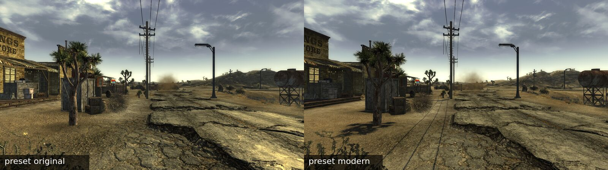
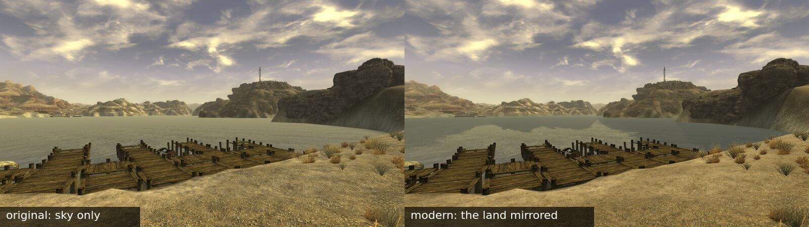
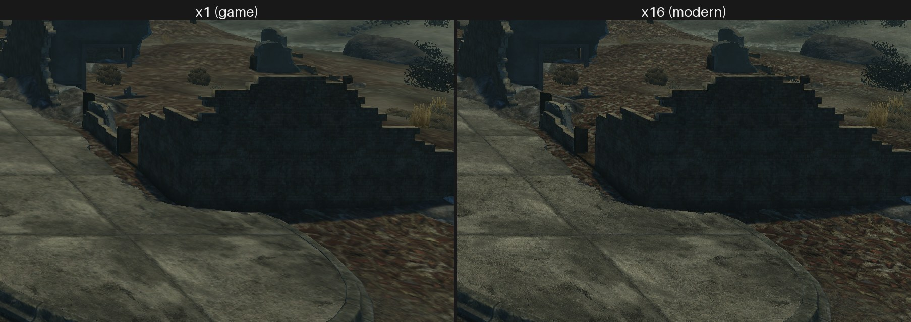

# What the fork adds, in detail

The [README](../../README.md) gives the short version. This page keeps the details that used to be in it: the fork's
reasons, the graphics settings, the other additions, the downloads and where to report problems.

## A fork of slaterain/nv-rs

The engine is slaterain's work. This fork follows upstream closely: upstream's commits are replayed onto our
default branch `fork` regularly, with their authors, dates and an `Upstream-Commit` trailer, so engine work done
upstream reaches this repository and its releases. `main` is an exact mirror of upstream's `main`.

We forked for two reasons. The work here is organised differently: required checks, Conventional Commits,
release-please, fuzzing, and Linux and Windows builds on every pull request (macOS on labelled ones). And we wanted to
make releases easily and often, for Linux, Windows and macOS, so that raul can ship a tested engine with every
version. How the fork follows upstream is in [FORK.md](../../FORK.md) and [KEEPING-IN-SYNC.md](KEEPING-IN-SYNC.md);
everything the fork changes in upstream's files is listed, with the reason, in [divergence.d/](divergence.d/). For the
project's own story, roadmap and community, read [upstream's README](https://github.com/slaterain/nv-rs#readme) and
join its [Discord](https://discord.gg/pn5kjZJJxx).

## raul: the easy way to play

[Raul's tRusty Toolbox](https://github.com/JorisJonkers-dev/rauls-trusty-toolbox) (`raul`) is one program for
Linux, Windows and macOS that finds your game, sets up Tale of Two Wastelands if you want it, installs and sorts
your mods, builds the distant land (LOD) for your load order, and starts the game on this engine. The engine is
built into raul, so there is nothing else to install.

**[Download raul](https://github.com/JorisJonkers-dev/rauls-trusty-toolbox/releases/latest)**: an AppImage, `.deb`
or `.tar.gz` for Linux, a setup `.exe` or portable `.zip` for Windows, and a `.dmg` for macOS. raul's
[README](https://github.com/JorisJonkers-dev/rauls-trusty-toolbox#readme) links the install steps and the checksums.

## Graphics presets and the F10 overlay

The engine draws the original picture by default. A graphics preset turns on the port's own effects together:
`original` (the default, every setting at the game's value), `modern` and `performance`. While the game runs,
**F10** opens an overlay that lists every setting, where its value comes from, and applies a change in the next
frame; the change is saved in the profile's `nv-rs-graphics.toml`. All of it is described in
[GRAPHICS.md](GRAPHICS.md).

  
   <em>Goodsprings, the same place and load order: preset <code>original</code> (left) and <code>modern</code> (right).
  Sun shadows, ambient occlusion and the light balance give the ground and buildings depth.</em>

What `modern` turns on, each also adjustable on its own:

| Setting | What it does |
| --- | --- |
| Ambient occlusion and sun shadows | The port's soft shade in corners and its shadows from the sun and moon, with quality levels and strength. Upstream has the effects; the fork makes them settings with levels and presets. |
| Light balance | The game's flat fill light is reduced where the port's own shade and the light from the sky take its place, so `modern` does not look washed out. |
| Sky light, moon and starlight | Light from the sky by surface direction, a moon light that follows the game's moon phase, and a dim starlight at night. |
| Moon highlight | Glossy materials catch the moon light a little. |
| Lamp light distance | Lamps, street lights and lit signs light their surroundings from further away. |
| Water reflections | Every outdoor lake and river (Lake Mead, the Colorado below Hoover Dam, the Potomac) mirrors the land, buildings and statics around it, not only the sky. |
| Anisotropic filtering | Textures seen at a grazing angle (roads, fences, roofs) stay sharp; `modern` uses x16. |
| Smooth gradients | The night sky, fog and sunsets show no hard colour bands: the frame is kept finer than 8 bits until it is shown, then spread into a fine, fixed grain. |

  
   <em>Lake Mead on a modded load order, the game's water (left) and <code>water.placed_reflections</code> high, as
  <code>modern</code> sets it (right): every outdoor lake and river mirrors the land, buildings and statics around it.</em>

  
   <em>Pavement and gravel at a grazing angle: the game's anisotropy at 1, as its Low and Medium settings set it
  (left), and forced x16 anisotropic filtering as <code>modern</code> sets it (right).</em>

Lamp light distance, water reflections, anisotropic filtering and smooth gradients are on the `fork` branch and come with the next
release after v0.24.0; the other settings are in v0.24.0.

## More

- **Linux and macOS.** The engine builds and runs natively on Linux (Vulkan through wgpu, X11 or Wayland, sound
  through the PulseAudio library, which PipeWire also serves); macOS builds are made and tested in part. See
  [LINUX.md](LINUX.md).
- **Tale of Two Wastelands starts.** For a game with Tale of Two Wastelands, the engine answers as installed for the
  script extenders TTW checks at a new game (JIP LN, JohnnyGuitar, ShowOff, lStewieAl's Tweaks and its own plugin).
  Loading the plugin DLLs of mods themselves is in progress and off by default
  ([ADR-0018](adr/0018-plugin-dlls-loaded.md)).
- **A library for other programs.** The crates `fork-api` and `fork-play` let a program link the engine and start
  a game from its own binary; that is how raul runs it ([ADR-0017](adr/0017-engine-linked-into-another-program.md),
  [CONSUMING.md](CONSUMING.md)).
- **Tools for checking the game.** `nv-rs-scene` takes pictures of named places with several settings in one run,
  compares them, and runs soaks, sweeps and benchmarks ([SCENE.md](SCENE.md)). Logs, stop reports and a hitch
  recorder help find faults ([LOGGING.md](LOGGING.md), [HITCHES.md](HITCHES.md)).
- **Discord Rich Presence** while the game runs ([DISCORD.md](DISCORD.md)).

## Downloads

Most players should use [raul](#raul-the-easy-way-to-play). The engine on its own is on the
[releases page](https://github.com/JorisJonkers-dev/nv-rs/releases/latest): a Windows setup `.exe` and preview
`.zip`, a Linux `.tar.gz` and a macOS `.tar.gz`, with checksum files, and OCI packages on ghcr.io for
Linux and Windows. To build from source, see [PLAYTESTING.md](../PLAYTESTING.md) and [LOCAL.md](LOCAL.md).

## Why raul and its parts are separate projects

raul is made of Components, each in its own repository: this engine, [nvmod-rs](https://github.com/JorisJonkers-dev/nvmod-rs)
(mods), [loot-rs](https://github.com/JorisJonkers-dev/loot-rs) (load order),
[lodwright-rs](https://github.com/JorisJonkers-dev/lodwright-rs) (distant land) and
[ttwright-rs](https://github.com/JorisJonkers-dev/ttwright-rs) (Tale of Two Wastelands). Each one can be used and
tested on its own, and releases on its own schedule; raul links them all into one program and releases them
together as one tested set.

## Contributing

Issues and pull requests for the fork's own work (graphics, Linux, macOS, releases, the parts raul uses) are welcome
here; read [CONTRIBUTING.md](../../CONTRIBUTING.md) and [PRACTICES.md](PRACTICES.md). Engine behaviour that differs
from the original game is best reported [upstream](https://github.com/slaterain/nv-rs/issues), where it reaches this
fork with the next sync. Every document is linked from [docs/README.md](../README.md).

## Legal and license

nv-rs is an independent project, not affiliated with or endorsed by Bethesda Softworks, ZeniMax Media, Obsidian
Entertainment or Microsoft. It contains no game files: you need your own legally obtained copy of the game. Original
code is licensed under the [GNU GPL v3 or later](../../LICENSE). The licence covers only original work. Fallout and
Fallout: New Vegas are trademarks of their respective owners. Read [LEGAL.md](../../LEGAL.md) for the full notice.
